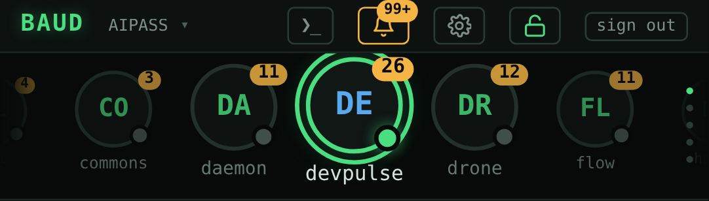
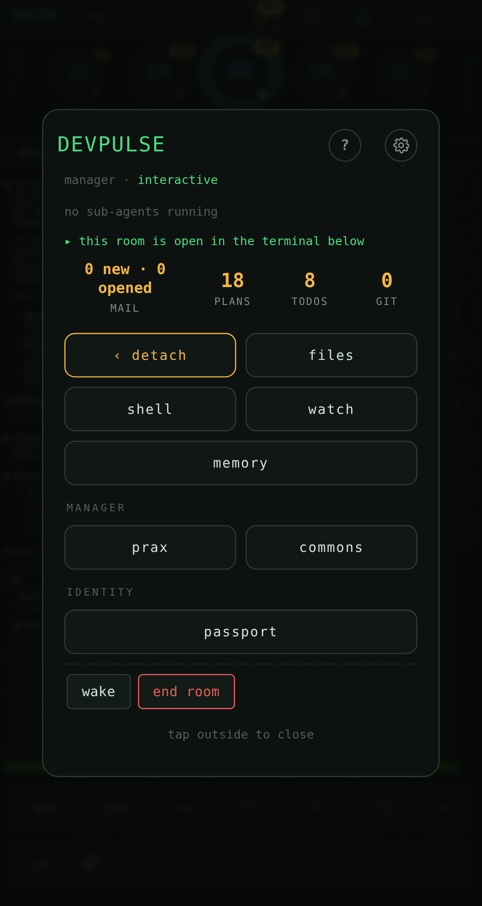
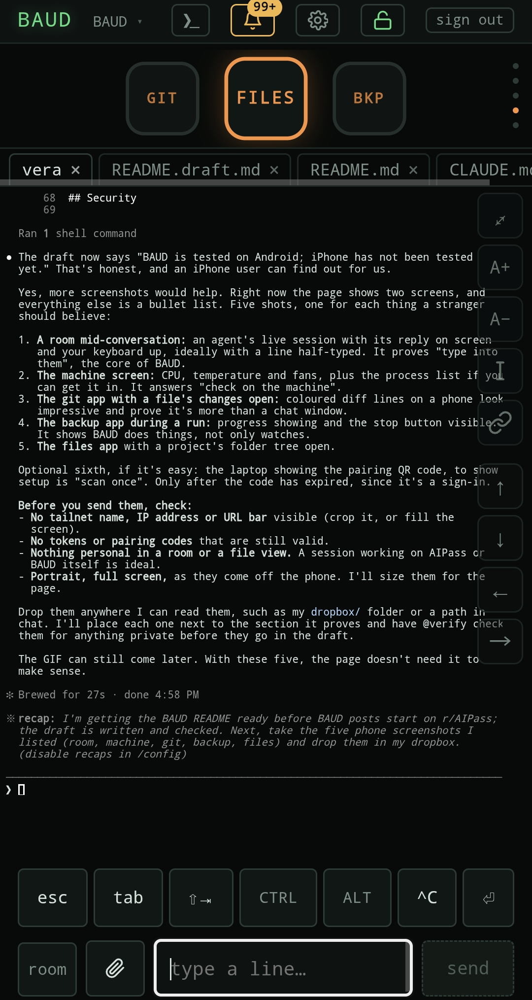
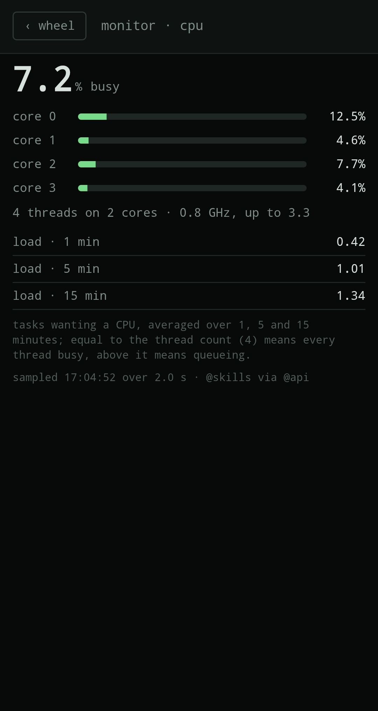
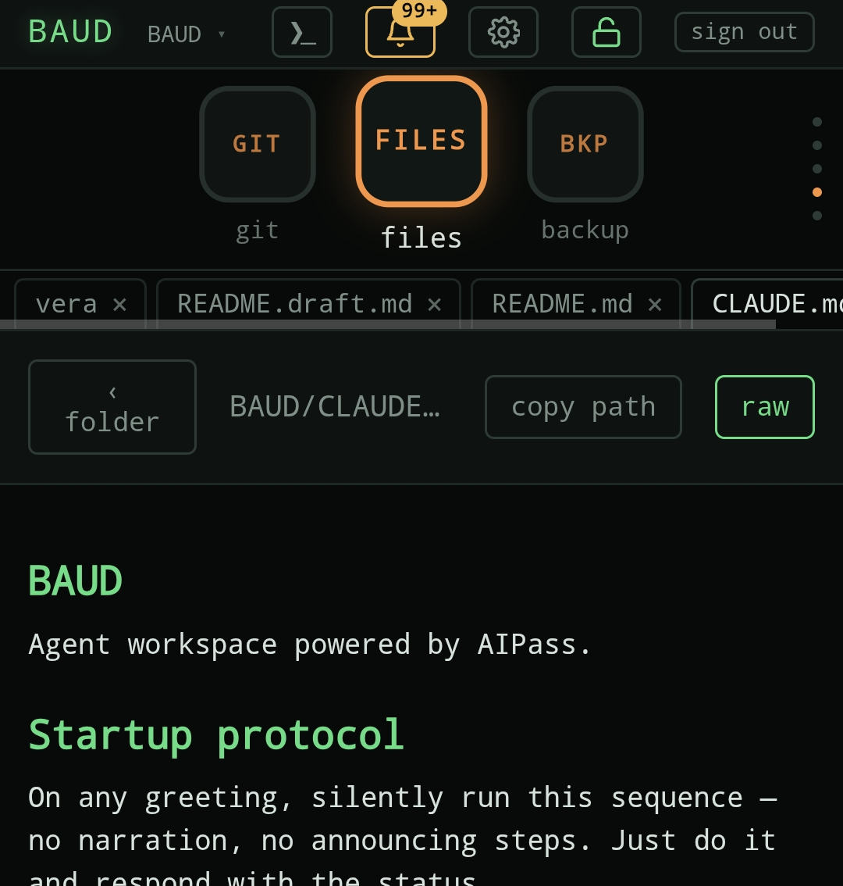
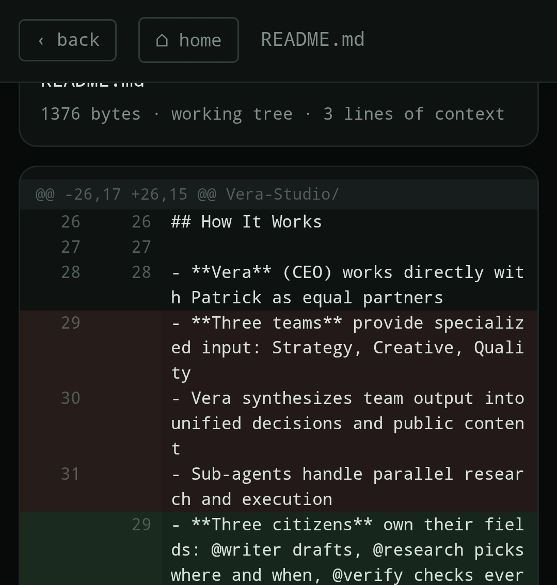
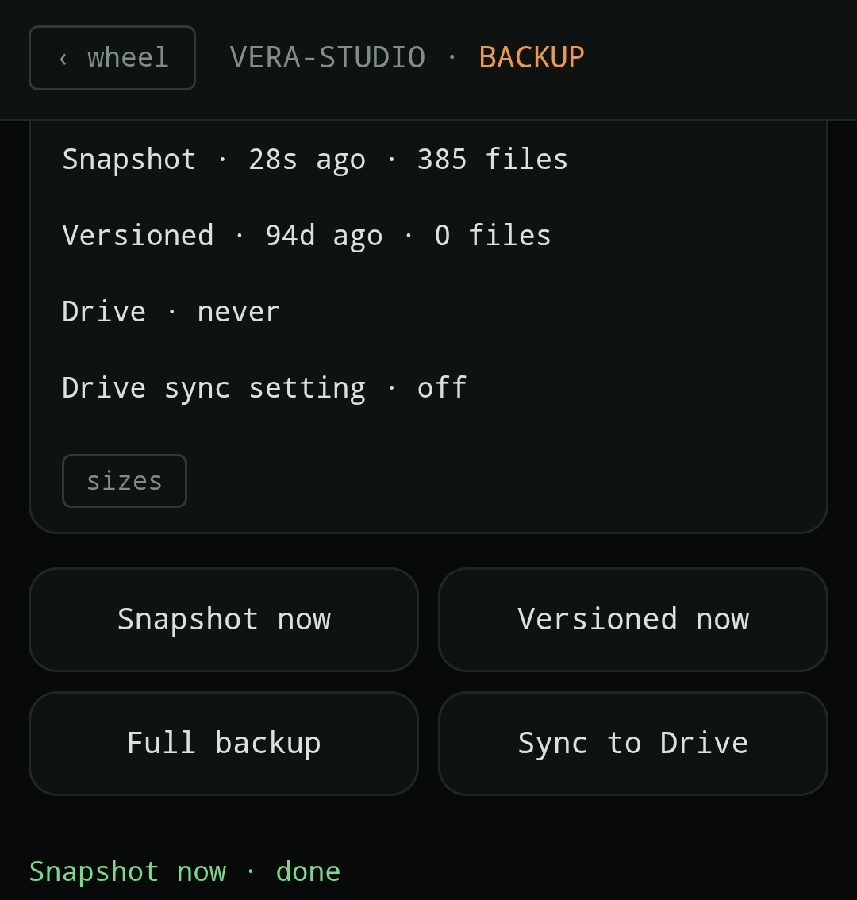

<h1 align="center">BAUD</h1>

<p align="center"><strong>Your AI agents, on your phone, served from your own machine.</strong></p>

<p align="center">See which of your Claude Code agents are working, open their live sessions, type into them, and check on the machine itself (CPU, memory, temperature), from your phone's browser. No account with us, no cloud, no telemetry.</p>

<p align="center">BAUD is the face of <a href="https://github.com/AIOSAI/AIPass">AIPass</a>, a framework of persistent Claude Code agents that keep their memory and mail each other work. It runs on your Linux machine, and installing BAUD installs AIPass too.</p>

<p align="center">
  
</p>

## What you get

**The wheel.** Every agent in one flick, with live state, mail and memory; the project switcher in the header moves you between projects.

**The card.** Tap an agent: what it is doing now, its mail, plans and todos, and the doors to its room, files, shell and memory.

<p align="center">
  
</p>

**Rooms.** An agent's live terminal session. Read it, type into it, send it a photo.

<p align="center">
  
</p>

**The machine.** CPU, memory, temperature, fans, network, processes and battery, live.

<p align="center">
  
</p>

**Apps on the phone.** Files, git and backups for your projects.

<p align="center">
  
  
  
</p>
<p align="center"><sub>A project file in the files app · a file's changes in the git app · the backup app</sub></p>

A desktop app is under development; today it runs from source ([docs/desktop.md](docs/desktop.md)).

## What it needs

- **Linux on x86_64** for the machine.
- **[Tailscale](https://tailscale.com) on the machine and on the phone.** The phone reaches your machine over your own tailnet, so you need a Tailscale account.
- **[Claude Code](https://claude.com/claude-code)**, signed in to your Anthropic account.
- git, tmux, curl and Python 3.10 or newer.

The installer checks each one and offers to install whatever is missing, one at a time, asking first. It names `sudo` wherever it needs it.

## Install

```sh
curl -fsSL https://github.com/AIOSAI/baud/releases/latest/download/install.sh | sh
```

The script prints what the machine has, installs what is missing after one Enter, installs the `aipass` CLI from PyPI, and runs `aipass install`. That clones AIPass into `~/AIPass` and lands this release's phone face. It never overwrites an existing `AIPass` folder. To install under another folder, name the parent:

```sh
curl -fsSL https://github.com/AIOSAI/baud/releases/latest/download/install.sh | sh -s -- ~/Projects
```

The careful path: read the script and check its sum first.

```sh
curl -fsSLO https://github.com/AIOSAI/baud/releases/latest/download/install.sh
curl -fsSLO https://github.com/AIOSAI/baud/releases/latest/download/SHA256SUMS.txt
sha256sum -c --ignore-missing SHA256SUMS.txt
sh install.sh
```

[docs/uninstall.md](docs/uninstall.md) says how to undo everything it did.

## First run on your phone

The installer ends by asking you to press Enter when your phone's camera is ready, then shows a QR code. Point the camera at it, tap the link, and the phone signs itself in. The code works once, for five minutes; `drone @api host-api pair phone --scope operate` makes a fresh one. Step by step for Android: [docs/phone-setup-android.md](docs/phone-setup-android.md). BAUD is tested on Android; iPhone has not been tested yet.

## Security

A token is the access right. A `read` token sees what your machine can read; an `operate` token is a shell as your user. Guard a token like an SSH key, give each device its own, and revoke a token the moment a phone is lost. [SECURITY.md](SECURITY.md) has the full model and how to report a problem.

## Status

Pre-release, `0.x`. Linux only, and the surface still moves. Changes are listed in [CHANGELOG.md](CHANGELOG.md). Dev logs and BAUD posts: [r/AIPass](https://reddit.com/r/AIPass).

## Docs

- [The phone face](docs/phone.md): the index, and why each screen works the way it does.
  - [The wheel](docs/phone/wheel.md) · [The card](docs/phone/card.md) · [The room](docs/phone/room.md) · [Room input](docs/phone/room-input.md) · [Room delivery](docs/phone/room-delivery.md)
  - [Files and git](docs/phone/files-git.md) · [Backup](docs/phone/backup.md) · [Monitor](docs/phone/monitor.md) · [Settings and navigation](docs/phone/settings-nav.md) · [Files](docs/phone/files.md)
- [The desktop window](docs/desktop.md) (under development): [window and cards](docs/desktop/window-and-cards.md) · [rooms](docs/desktop/rooms.md) · [settings](docs/desktop/settings.md)
- [The headless doors](docs/headless.md): `baud-cli` and the same answers without a window.
- [Architecture](docs/architecture.md) · [Development](docs/development.md) · [The install sandbox](docs/sandbox.md) · [Releases](docs/releases.md)
- [CHANGELOG.md](CHANGELOG.md) · [MAP.md](MAP.md): where every file lives.

## Contributing

Fork the repo, branch off `dev`, and open a pull request against `dev`. An installed copy is an appliance that tracks its branch; contributing happens in your fork. See [CONTRIBUTING.md](CONTRIBUTING.md).

## Licence

MIT. See [LICENSE](LICENSE).
